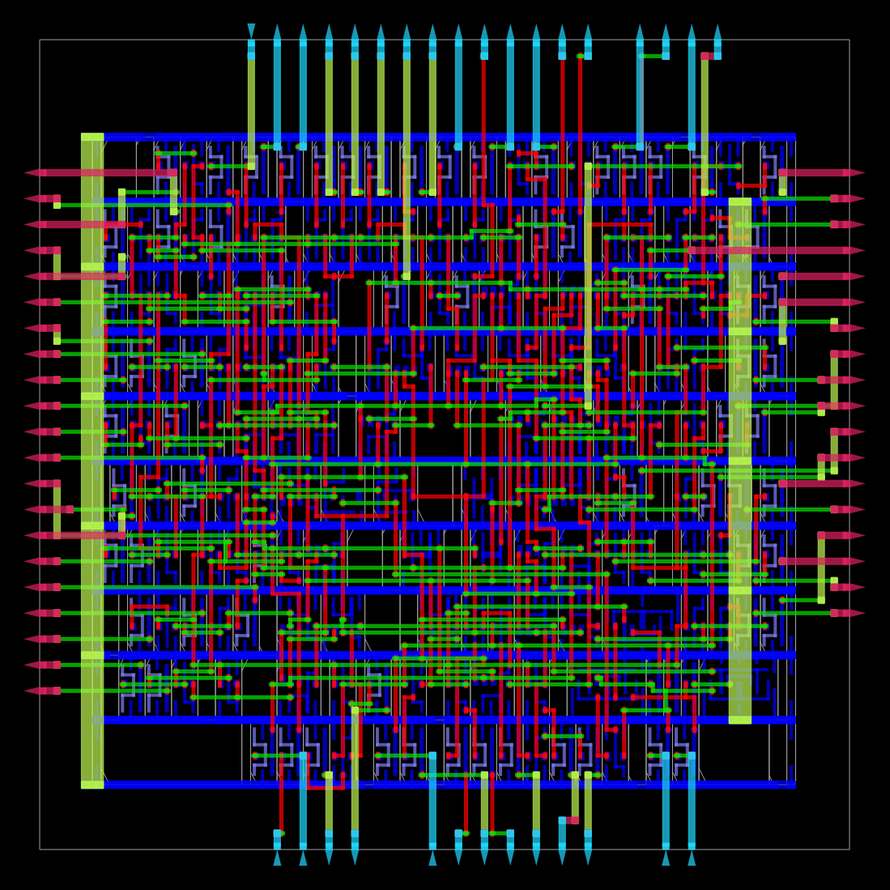

<div align="center">


<p>
  
  
  
</p>

**A 6-bit input selects exactly one of 64 output bits.**

[⬅ Back to repository](../../README.md)

</div>

---

## 🎯 Objective

Implement a combinational **6-to-64 one-hot decoder** in SystemVerilog, verify all possible input values with a self-checking testbench, and inspect the results from an introductory OpenROAD Flow Scripts (ORFS) physical-design run.

## 🧠 Design Specification

| Signal | Width | Direction | Description |
|---|---:|---|---|
| `I` | 6 bits | Input | Selects output index 0–63 |
| `Y` | 64 bits | Output | One-hot decoded output |

For each input value (I), exactly one output bit is high:

`Y = 64'b1 << I`

For example, when `I = 0`, `Y[0] = 1`. When `I = 5`, `Y[5] = 1`. All other output bits are zero.

## 🧩 RTL Implementation

File: `decoder_6to64.sv`

```systemverilog
module decoder_6to64 (
    input  logic [5:0]  I,
    output logic [63:0] Y
);

    assign Y = 64'b1 << I;

endmodule
```

The shift expression moves a single bit to the position selected by `I`. The design is combinational and does not use a clock.

## ✅ Verification

The testbench, `tb_decoder_6to64.sv`, iterates through all 64 possible input values. For each value it calculates the expected one-hot output, waits briefly for combinational settling, and compares the actual and expected results using case inequality (`!==`). If a mismatch is found, it prints the input and values before calling `$fatal`.

### Run the testbench

Requirements: Icarus Verilog with SystemVerilog support.

From this directory:

```bash
iverilog -g2012 -s tb_decoder_6to64 \
  -o sim.out decoder_6to64.sv tb_decoder_6to64.sv

vvp sim.out
```

A successful run reaches `$finish` without a decoder-verification failure.

## 🏗️ Physical-Design Artifacts

The project includes artifacts from an introductory ORFS run using the **Nangate45** platform.

| Artifact | Purpose |
|---|---|
| [`decoder_6to64_layout.png`](decoder_6to64_layout.png) | Static layout visualization |
| [`openroad_results/6_final.odb`](openroad_results/6_final.odb) | OpenDB physical-design database |
| [`openroad_results/6_final.def`](openroad_results/6_final.def) | Design Exchange Format layout description |
| [`openroad_results/6_final.gds`](openroad_results/6_final.gds) | GDS layout output |
| [`load_decoder.tcl`](load_decoder.tcl) | OpenROAD Tcl commands to load the saved database and fit the view |

### Layout snapshot

<p align="center">
  <a href="decoder_6to64_layout.png">
    
  </a>
</p>

### Reopen the saved layout in OpenROAD

From this directory, start the Docker container:

```bash
docker run --rm -it \
  -e DISPLAY="${DISPLAY:-:0}" \
  -v /tmp/.X11-unix:/tmp/.X11-unix \
  -v "$PWD:/project" \
  openroad/orfs:latest bash
```

Inside the container, launch the GUI:

```bash
/OpenROAD-flow-scripts/tools/install/OpenROAD/bin/openroad -gui
```

In the OpenROAD Tcl console, run:

```tcl
source /project/load_decoder.tcl
```

The script loads `/project/openroad_results/6_final.odb` and fits the layout into the view. These are OpenROAD Tcl commands, not Bash commands.

## ⚠️ Scope and Limitations

- This is an introductory physical-design exercise, not a signoff-qualified chip implementation.
- A prior timing log reported that clock `*` was not found. Treat the saved physical artifacts as evidence of flow execution and layout generation—not proof of timing closure.
- The project does not claim manufacturing readiness or tapeout.
- The current implementation uses a concise shift-based expression; alternative hierarchical implementations can be explored as future exercises.

## 📁 Files

```text
01_Decoder_6to64/
├── README.md
├── decoder_6to64.sv
├── tb_decoder_6to64.sv
├── decoder_6to64_layout.png
├── load_decoder.tcl
├── sim.out
└── openroad_results/
    ├── 6_final.odb
    ├── 6_final.def
    └── 6_final.gds
```

---

[⬅ Back to RTL-to-GDSII Projects](../../README.md) · [Open the DFF project](../02_D_ff/README.md)
