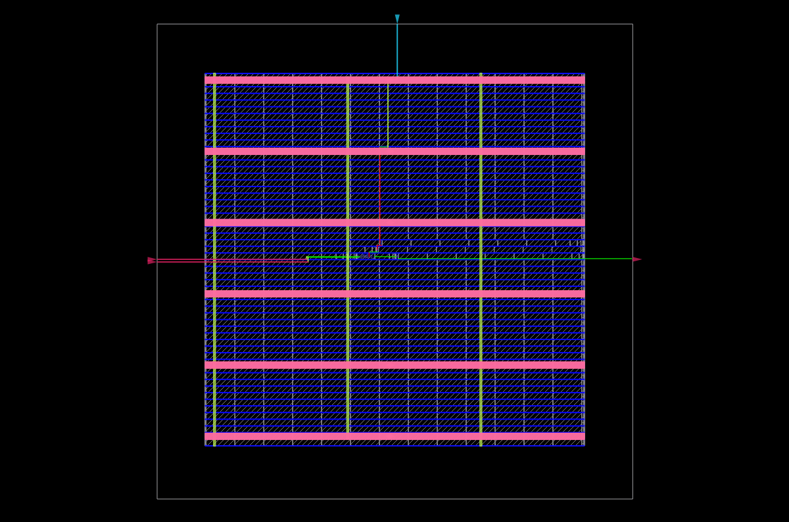

<div align="center">


<p>
  
  
  
</p>

**A positive-edge-triggered D flip-flop with an active-high asynchronous reset.**

[⬅ Back to repository](../../README.md)

</div>

---

## 🎯 Objective

Implement a resettable D flip-flop in SystemVerilog, verify its basic behavior with a Python/Cocotb testbench running through Verilator, and explore synthesis and physical implementation using OpenROAD Flow Scripts (ORFS).

## 🧠 Design Specification

| Signal | Direction | Description |
|---|---|---|
| `D` | Input | Data sampled at the active clock edge |
| `clk` | Input | Rising-edge-triggered clock |
| `rst` | Input | Active-high asynchronous reset |
| `Q` | Output | Stored one-bit state |

Behavior:

- When `rst = 1`, `Q` is asynchronously cleared to zero.
- When reset is inactive, `Q` captures `D` on `posedge clk`.
- Between active clock edges, `Q` retains its stored value.

## 🧩 RTL Implementation

File: `Dff.sv`

```systemverilog
module Dff (
    input  logic D, clk, rst,
    output logic Q
);

    always_ff @(posedge clk or posedge rst) begin
        if (rst)
            Q <= '0;
        else
            Q <= D;
    end

endmodule
```

This uses SystemVerilog's `always_ff` construct and non-blocking assignments. The unsized unbased literal `'0` fills the destination with zeros.

## ✅ Cocotb Verification

The Python testbench is `tb_Dff.py`; the runner is `run.py`.

The current test:
1. Initializes the inputs.
2. Asserts reset and checks that `Q` clears.
3. Releases reset.
4. Applies both data values, generates rising clock edges, and checks captured output values.

The committed `results.xml` records one test with zero errors, zero failures, and zero skipped tests for that run. This is evidence for that test run, not exhaustive verification of every possible reset/clock interaction.

### Run the test

From this directory, activate the existing local virtual environment and run the Python runner:

```bash
source ~/vlsi_workspace/.venv/bin/activate
python3 -m py_compile tb_Dff.py
python3 run.py
```

The virtual-environment path is specific to my local WSL/Ubuntu setup. On another machine, create an environment and install compatible Cocotb and simulator dependencies.

## 🏗️ Synthesis and Physical Design

This project was taken through an ORFS run using Docker and the **Nangate45** platform. The design configuration and constraints are:

- [`Dff_config.mk`](Dff_config.mk) — design, platform, RTL input, SDC path, and explicit die/core dimensions.
- [`Dff.sdc`](Dff.sdc) — example clock and I/O delay assumptions.
- `orfs/results/nangate45/Dff/base/` — generated flow results.

### Generated artifacts

| Artifact | Purpose |
|---|---|
| [`Dff_layout.png`](Dff_layout.png) | Static OpenROAD layout image |
| [`6_final.odb`](orfs/results/nangate45/Dff/base/6_final.odb) | Final OpenDB physical-design database |
| [`6_final.def`](orfs/results/nangate45/Dff/base/6_final.def) | Final DEF layout description |
| [`6_final.gds`](orfs/results/nangate45/Dff/base/6_final.gds) | Generated GDS layout output |
| [`6_final.v`](orfs/results/nangate45/Dff/base/6_final.v) | Final mapped Verilog netlist |

### Layout snapshot

<p align="center">
  <a href="Dff_layout.png">
    
  </a>
</p>

### Run the ORFS flow again

Docker and the `openroad/orfs:latest` image are required. From this directory:

```bash
docker run --rm -it \
  -v "$PWD:/project" \
  openroad/orfs:latest \
  bash -lc 'cd /OpenROAD-flow-scripts/flow && make DESIGN_CONFIG=/project/Dff_config.mk WORK_HOME=/project/orfs'
```

ORFS runs the configured synthesis and physical-design stages. The flow may overwrite or regenerate files under `orfs/`.

### Reopen the saved layout without rerunning the flow

From this directory, launch a GUI-enabled container:

```bash
docker run --rm -it \
  -e DISPLAY="${DISPLAY:-:0}" \
  -v /tmp/.X11-unix:/tmp/.X11-unix \
  -v "$PWD:/project" \
  openroad/orfs:latest bash
```

Inside the container:

```bash
/OpenROAD-flow-scripts/tools/install/OpenROAD/bin/openroad -gui
```

In the OpenROAD Tcl console:

```tcl
read_db /project/orfs/results/nangate45/Dff/base/6_final.odb
gui::fit
```

## ⚠️ Timing and Signoff Limitations

The SDC uses a 10 ns clock period and zero input/output delays as **learning assumptions**. These have not been validated against external interface requirements. A successful ORFS run and a visible layout are not, by themselves, proof of timing closure or physical-design signoff.

The project is intended to demonstrate RTL, testbench, synthesis, and introductory physical-design workflow—not production readiness or tapeout.

## 📁 Files

```text
02_D_ff/
├── README.md
├── Dff.sv
├── tb_Dff.py
├── run.py
├── Dff.sdc
├── Dff_config.mk
├── Dff_netlist.v
├── Dff_layout.png
├── results.xml
├── sim_build/
└── orfs/
    └── results/nangate45/Dff/base/
        ├── 6_final.odb
        ├── 6_final.def
        ├── 6_final.gds
        └── 6_final.v
```

---

[⬅ Back to RTL-to-GDSII Projects](../../README.md) · [Open the decoder project](../01_Decoder_6to64/README.md)
