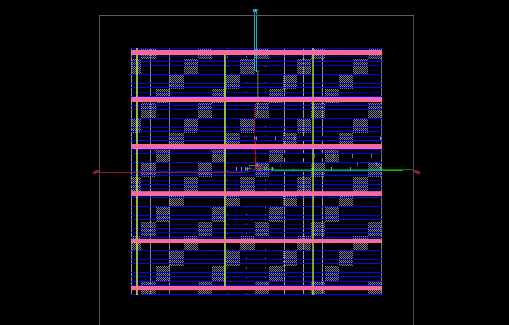

<div align="center">


<p>
  
  
  
</p>

**A clocked JK flip-flop demonstrating hold, reset, set, and toggle behavior.**

[⬅ Back to repository](../../README.md)

</div>

---

## 🎯 Objective

Implement a JK flip-flop in SystemVerilog, verify its four input combinations using a Python/Cocotb testbench running with Verilator, and inspect synthesis and physical-design artifacts generated by OpenROAD Flow Scripts (ORFS).

## 🧠 Design Specification

| Signal | Direction | Description |
|---|---|---|
| `clk` | Input | Rising-edge-triggered clock |
| `rst` | Input | Active-high asynchronous reset |
| `J` | Input | Set / toggle control input |
| `K` | Input | Reset / toggle control input |
| `Q` | Output | Stored one-bit state |
| `Qn` | Output | In this RTL, this signal carries the combinational next-state value used to update `Q` |

The state updates on `posedge clk`; asserting `rst` clears `Q` asynchronously.

### JK truth table

| J | K | Next state | Operation |
|---:|---:|---|---|
| 0 | 0 | `Q(next) = Q` | Hold |
| 0 | 1 | `Q(next) = 0` | Reset |
| 1 | 0 | `Q(next) = 1` | Set |
| 1 | 1 | `Q(next) = ~Q` | Toggle |

The RTL computes the next state combinationally and captures it at the next rising clock edge. The signal named `Qn` is **not a conventional complementary output** in this implementation; it is a next-state signal. A future cleanup could rename it to `next_Q` and expose `~Q` separately only if a complementary output is required.

## 🧩 RTL Implementation

File: `JK_FF.sv`

```systemverilog
module JK_FF (
    input  logic clk, rst, J, K,
    output logic Q, Qn
);
    always_ff @(posedge clk or posedge rst) begin
        if (rst)
            Q <= 1'b0;
        else
            Q <= Qn;
    end

    always_comb begin
        if (J == 1'b0 && K == 1'b0)
            Qn = Q;       // Hold
        else if (J == 1'b0 && K == 1'b1)
            Qn = 1'b0;    // Reset
        else if (J == 1'b1 && K == 1'b0)
            Qn = 1'b1;    // Set
        else
            Qn = ~Q;      // Toggle
    end
endmodule
```

The `always_ff` block stores state and the `always_comb` block calculates the next state from `J`, `K`, and the current `Q`.

## ✅ Cocotb Verification

The Python testbench is `tb_JK_FF.py`; `run.py` builds and runs the test with Verilator.

The current test:
1. Initializes the inputs and asserts asynchronous reset.
2. Checks that reset clears `Q`.
3. Releases reset.
4. Applies all four `(J, K)` combinations, computes the expected next state from the pre-edge state, and checks `Q` after a rising edge.

The committed `results.xml` reports one test with zero errors, zero failures, and zero skipped tests for that run. This confirms the recorded test completed successfully; it does not constitute exhaustive verification.

### Run the test

From this directory, activate the local environment configured on the development machine and run:

```bash
source ~/vlsi_workspace/.venv/bin/activate
python3 -m py_compile tb_JK_FF.py
python3 run.py
```

The virtual-environment path is specific to the local WSL/Ubuntu setup. On another system, install compatible Cocotb and Verilator versions in your own environment.

## 🏗️ Synthesis and Physical Design

The repository contains artifacts from an ORFS run using the **Nangate45** platform.

- `JK_FF_config.mk` — design name, platform, source file, SDC, and floorplan dimensions.
- `JK_FF.sdc` — example clock and I/O timing constraints.
- `orfs/results/nangate45/JK_FF/base/` — generated physical-design results.

### Generated artifacts

| Artifact | Purpose |
|---|---|
| [`JK_FF_layout.png`](JK_FF_layout.png) | Static physical-layout image |
| [`6_final.odb`](orfs/results/nangate45/JK_FF/base/6_final.odb) | Final OpenDB physical-design database |
| [`6_final.def`](orfs/results/nangate45/JK_FF/base/6_final.def) | Final DEF layout description |
| [`6_final.gds`](orfs/results/nangate45/JK_FF/base/6_final.gds) | Generated GDS layout output |
| [`6_final.v`](orfs/results/nangate45/JK_FF/base/6_final.v) | Final mapped Verilog netlist |

### Layout snapshot

<p align="center">
  <a href="JK_FF_layout.png">
    
  </a>
</p>

### Re-run the ORFS flow

Docker and the `openroad/orfs:latest` image are required. From this directory:

```bash
docker run --rm -it \
  -v "$PWD:/project" \
  openroad/orfs:latest \
  bash -lc 'cd /OpenROAD-flow-scripts/flow && make DESIGN_CONFIG=/project/JK_FF_config.mk WORK_HOME=/project/orfs'
```

The flow may regenerate files under `orfs/`.

## ⚠️ Constraints and Signoff Limitations

**Fix the SDC before treating a rerun as a valid constrained timing analysis.** The current `JK_FF.sdc` refers to ports `D` and `Q`, but the RTL ports are `clk`, `rst`, `J`, `K`, `Q`, and `Qn`. The input-delay constraint for `D` therefore does not match this module. Update the constraints to describe `J`, `K`, reset, and relevant outputs, and then inspect the timing reports.

The 10 ns clock and zero-delay assumptions are educational defaults, not validated interface requirements. A successful run and a generated GDS file are not proof of timing closure, signoff, manufacturing readiness, or tapeout.

## 📁 Files

```text
03_JK_FF/
├── README.md
├── JK_FF.sv
├── tb_JK_FF.py
├── run.py
├── JK_FF.sdc
├── JK_FF_config.mk
├── JK_FF_layout.png
├── JK_FF_netlist.v
├── results.xml
├── sim_build/
└── orfs/
    └── results/nangate45/JK_FF/base/
        ├── 6_final.odb
        ├── 6_final.def
        ├── 6_final.gds
        └── 6_final.v
```

---

[⬅ Back to RTL-to-GDSII Projects](../../README.md) · [Open the DFF project](../02_D_ff/README.md) · [Open the decoder project](../01_Decoder_6to64/README.md)
