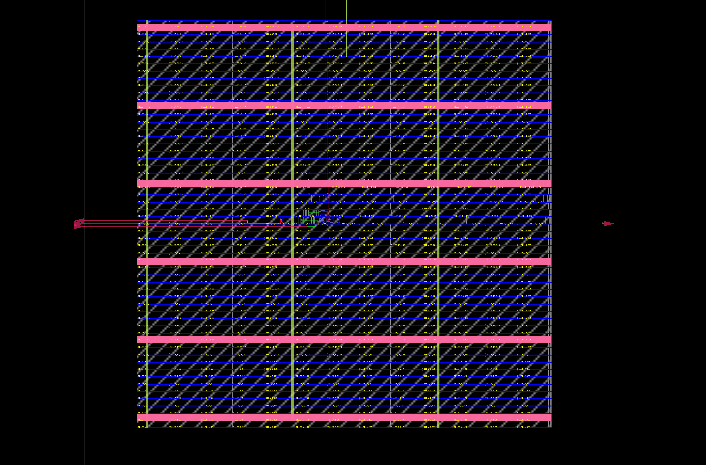

<div align="center">


<p>
  
  
  
</p>

**A clocked SR flip-flop exploring set, reset, hold, and the invalid input combination.**

[⬅ Back to repository](../../README.md)

</div>

---

## 🎯 Objective

Implement an SR flip-flop in SystemVerilog, verify its behavior with a Python/Cocotb testbench using Verilator, and inspect the synthesis and physical-design artifacts generated by OpenROAD Flow Scripts (ORFS).

## 🧠 Design Specification

| Signal | Direction | Description |
|---|---|---|
| `clk` | Input | Rising-edge-triggered clock |
| `rst` | Input | Active-high asynchronous reset |
| `S` | Input | Set control |
| `R` | Input | Reset control |
| `Q` | Output | Stored one-bit state |
| `Qn` | Output | In this RTL, a combinational next-state signal; it is not the complement of Q |

The state updates on the rising clock edge. Asserting `rst` asynchronously clears `Q`.

### SR truth table

| S | R | Next state | Operation |
|---:|---:|---|---|
| 0 | 0 | `Q(next) = Q` | Hold |
| 0 | 1 | `Q(next) = 0` | Reset |
| 1 | 0 | `Q(next) = 1` | Set |
| 1 | 1 | Invalid (`X`) | Forbidden / invalid |

The RTL uses `Qn` to calculate the next state. Despite its common use as a name for the inverse output, **`Qn` is not a conventional Q-bar output in this implementation**.

## 🧩 RTL Implementation

File: `SR_FF.sv`

```systemverilog
module SR_FF (
    input  logic clk, rst, S, R,
    output logic Q, Qn
);
    always_ff @(posedge clk or posedge rst) begin
        if (rst)
            Q <= 1'b0;
        else
            Q <= Qn;
    end

    always_comb begin
        if (!S && !R)
            Qn = Q;       // Hold
        else if (!S && R)
            Qn = 1'b0;    // Reset
        else if (S && !R)
            Qn = 1'b1;    // Set
        else
            Qn = 1'bx;    // Invalid input combination
    end
endmodule
```

## ✅ Cocotb Verification

The Python test is in `tb_SR_FF.py`, and `run.py` provides the project runner.

The intended checks are:
1. Assert asynchronous reset and check that `Q` becomes zero.
2. Release reset.
3. Apply the four S/R combinations and compare the stored state against the expected behavior.
4. Treat `S=1, R=1` as invalid.

**Verification note:** Review and strengthen the current testbench before treating its output as a complete pass. In the current script, the final state comparison is written as a bare expression rather than an `assert`, so it does not fail the test on a mismatch. Also, `exp_Q` is not assigned for the invalid combination, and the test does not generate a separate clock process. The invalid case should be checked according to the chosen simulation policy rather than counted as a normal binary state test.

### Run the test

From this directory in the configured WSL/Ubuntu environment:

```bash
source ~/vlsi_workspace/.venv/bin/activate
python3 -m py_compile tb_SR_FF.py
python3 run.py
```

The environment path is specific to the original development setup. Install compatible Cocotb and Verilator versions if running elsewhere.

## 🏗️ Synthesis and Physical Design

This project contains artifacts from an ORFS run using the **Nangate45** educational standard-cell platform.

### Layout snapshot

<p align="center">
  <a href="SR_FF_layout.png">
    
  </a>
</p>

Click the image to open it at its original resolution.

### Useful artifacts

| Artifact | Purpose |
|---|---|
| [`SR_FF_layout.png`](SR_FF_layout.png) | Static view of the physical layout |
| [`6_final.odb`](orfs/results/nangate45/SR_FF/base/6_final.odb) | Final OpenDB physical-design database |
| [`6_final.def`](orfs/results/nangate45/SR_FF/base/6_final.def) | Final DEF layout description |
| [`6_final.gds`](orfs/results/nangate45/SR_FF/base/6_final.gds) | Generated GDS layout data |
| [`6_final.v`](orfs/results/nangate45/SR_FF/base/6_final.v) | Final mapped Verilog netlist |

## ⚠️ Engineering Notes

A successful synthesis or physical-design run and a generated GDS file do not, by themselves, prove timing closure, signoff, manufacturing readiness, or tapeout readiness.

Before using this design beyond an educational exercise, ensure the SDC constraints match the actual clock and I/O ports, review timing reports, and correct the Cocotb testbench issues described above.

## 📁 Project Files

```text
04_SR_FF/
├── SR_FF.sv
├── tb_SR_FF.py
├── run.py
├── results.xml
├── SR_FF_layout.png
├── sim_build/
└── orfs/
    └── results/nangate45/SR_FF/base/
        ├── 6_final.odb
        ├── 6_final.def
        ├── 6_final.gds
        └── 6_final.v
```

---

[⬅ Back to RTL-to-GDSII Projects](../../README.md) · [Open the JK flip-flop project](../03_JK_FF/README.md) · [Open the DFF project](../02_D_ff/README.md)
